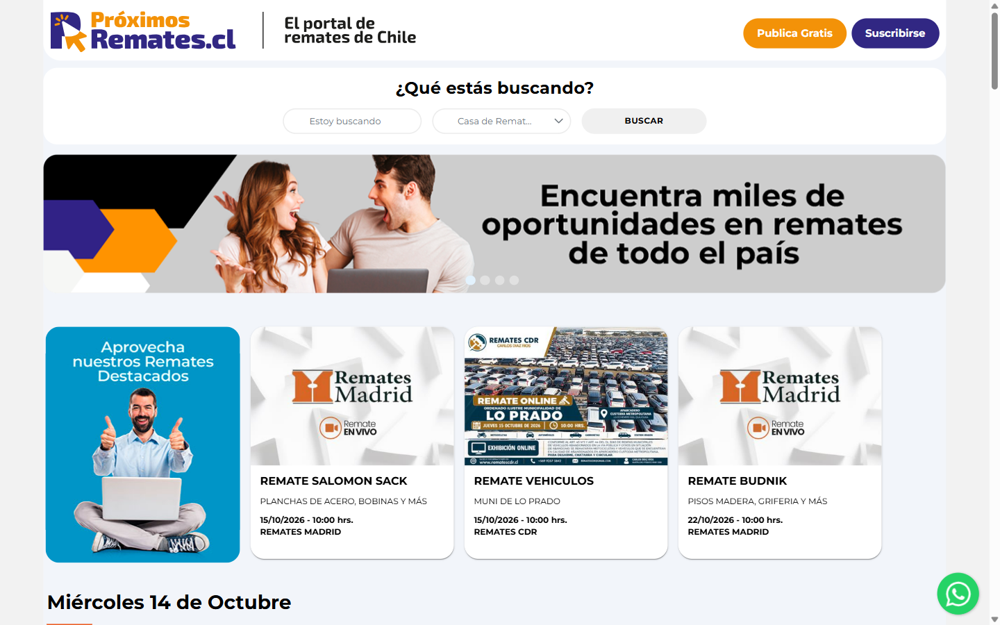
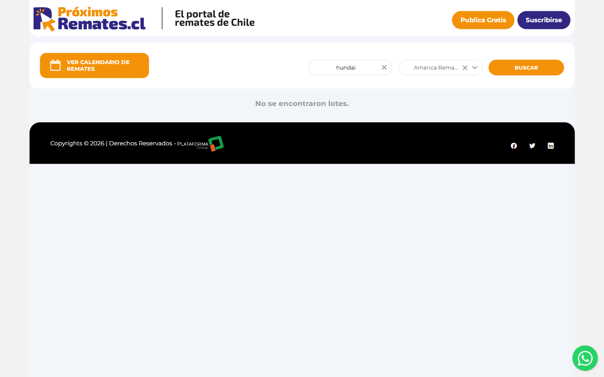
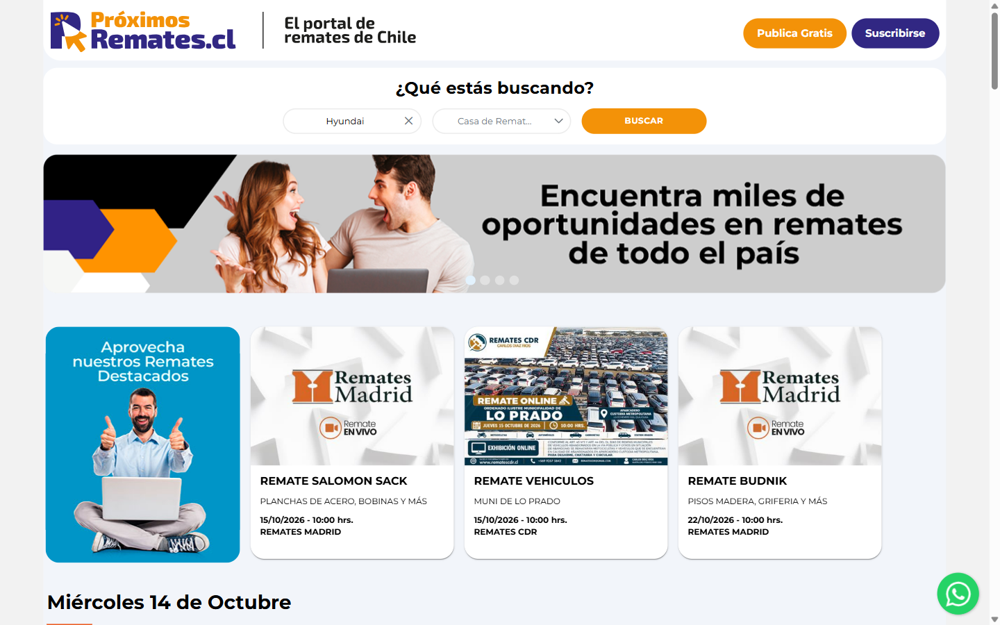
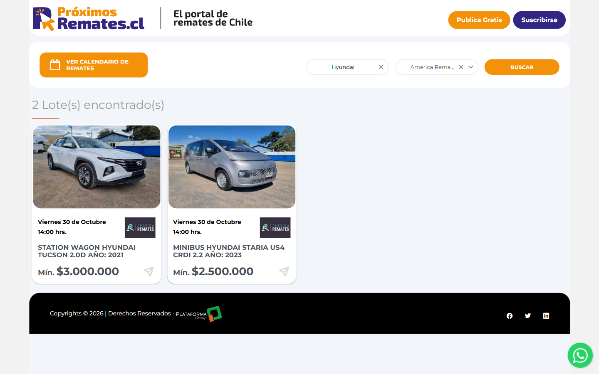
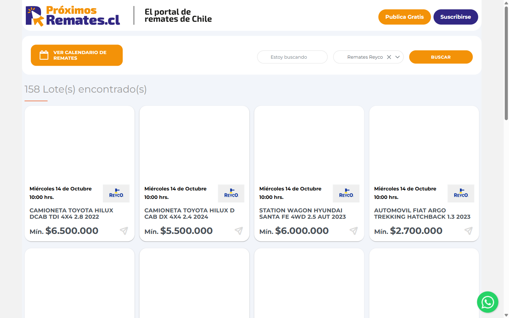
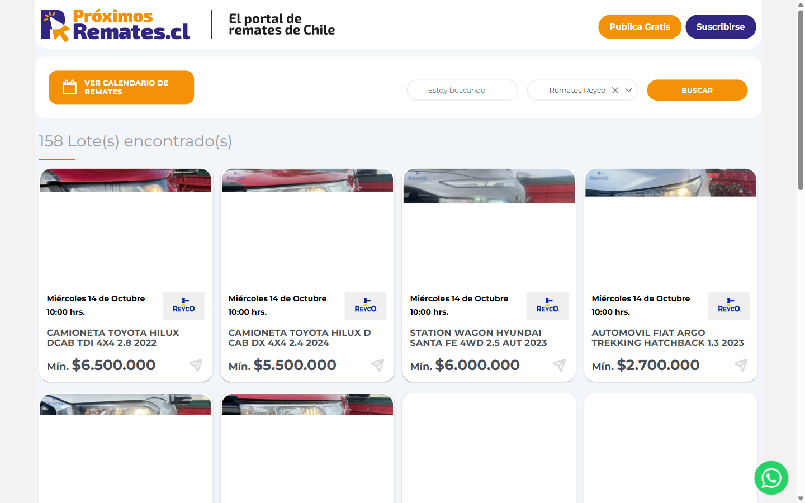
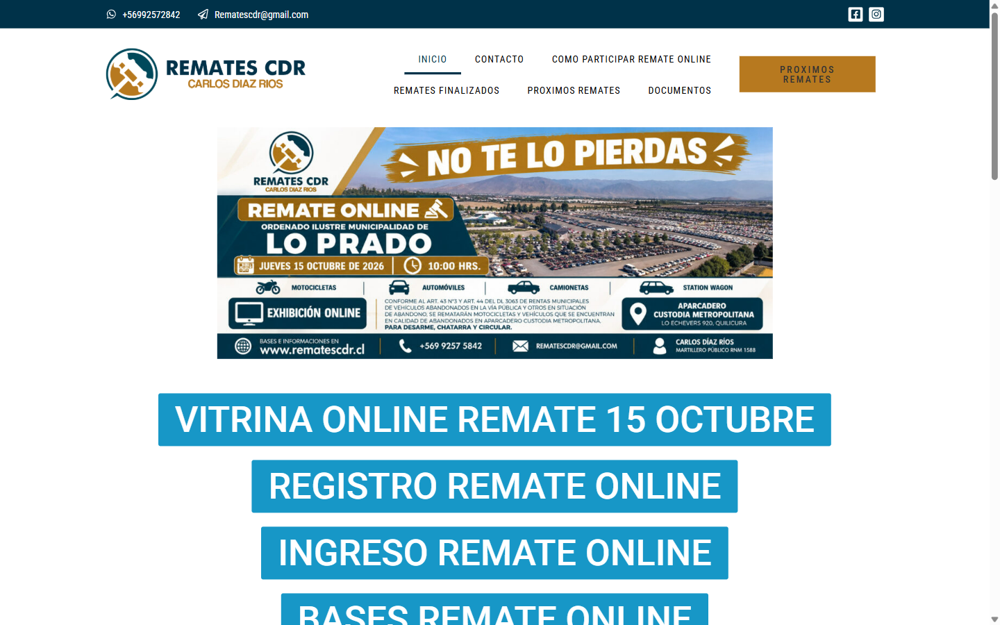
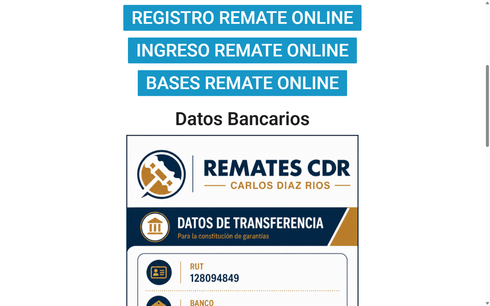
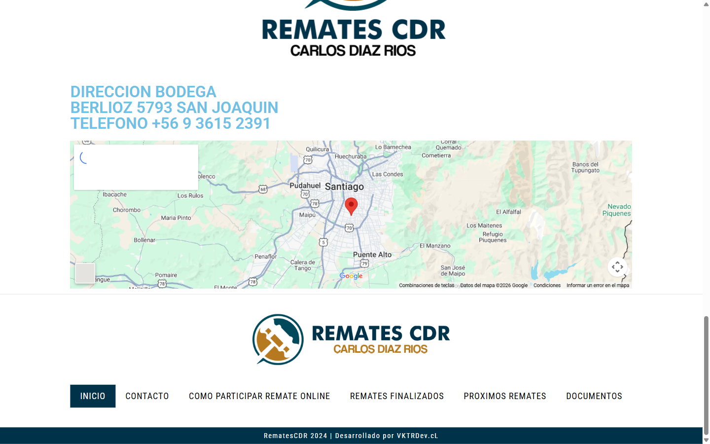
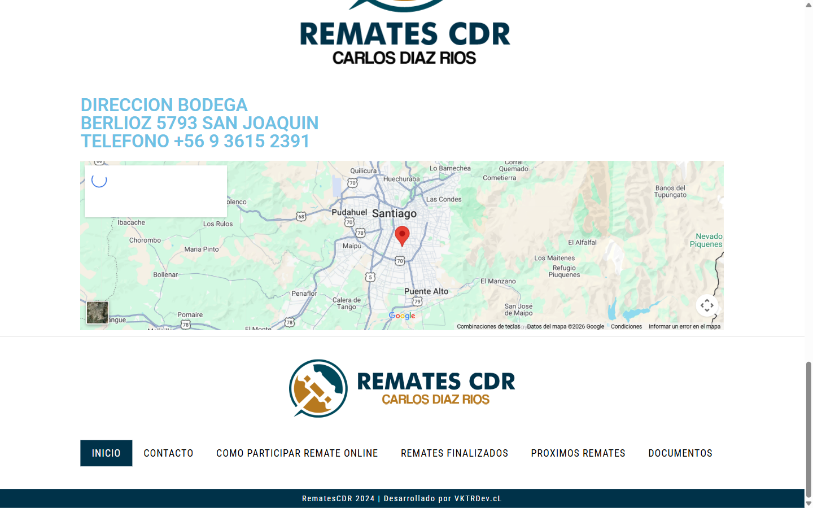

# Informe de automatización — QA Senior

**Nombre:** Emilio Silva
**Fecha/hora inicio:** 2026-10-14T17:44:24-03:00
**Fecha/hora término:** 2026-10-14T17:44:54-03:00
**Herramienta:** Python + Playwright + reportería propia (sin IA en runtime)
**Navegador:** Chromium (Playwright) 156.0.8078.4
**Sistema operativo:** Windows-11-10.0.26200-SP0
**URL probada:** https://www.proximosremates.cl
**Modo:** SITIO REAL

## Resumen

| Caso | Estado | Evidencias |
| --- | --- | ---: |
| Caso 1 - Búsqueda y filtrado (hundai) (Obligatorio) | **PASS** | 5 |
| Caso 1B - Control positivo Hyundai (adicional) (Adicional (no evaluable)) | **INCONCLUSO** | 5 |
| Caso 2 - Casas de remates y desplazamiento (Obligatorio) | **PASS** | 6 |

**Criterios:** PASS exige verificar todos los pasos previstos. Una búsqueda sin resultados es PASS solo si se detecta inequívocamente el estado vacío. INCONCLUSO y BLOQUEADO no se presentan como aprobados. El caso Hyundai es adicional; si no hay publicaciones se marca SIN_DATOS, nunca PASS ficticio ni fallo del ejercicio obligatorio.

## Caso 1 - Búsqueda y filtrado (hundai)

**Estado:** PASS

### Observaciones

- Ruta válida: búsqueda hundai sin resultados; evidencia del estado vacío registrada.

### Evidencias

**Paso 1 — Sitio cargado**

https://www.proximosremates.cl/#/

**Paso 2 — Busqueda hundai ingresada**

Valor exacto: `hundai`.

**Paso 3 — America Remates seleccionada**

**Paso 4 — Busqueda ejecutada**

https://www.proximosremates.cl/#/busqueda-avanzada?idCliente=35&descripcion=hundai

**Paso 5 — Estado de resultados**

Término: `hundai`. Detección: EMPTY. No se encontraron lotes.

## Caso 1B - Control positivo Hyundai (adicional)

**Estado:** INCONCLUSO

### Observaciones

- El portal informa 2 lote(s) encontrado(s). Aún no se identificó una tarjeta clicable para abrir detalles.

### Evidencias

**Paso 1 — Sitio cargado**

https://www.proximosremates.cl/#/

**Paso 2 — Busqueda Hyundai ingresada**

Valor exacto: `Hyundai`.

**Paso 3 — America Remates seleccionada**

**Paso 4 — Busqueda ejecutada**

https://www.proximosremates.cl/#/busqueda-avanzada?idCliente=35&descripcion=Hyundai

**Paso 5 — Estado de resultados**

Término: `Hyundai`. Detección: FOUND. El portal informa 2 lote(s) encontrado(s). Aún no se identificó una tarjeta clicable para abrir detalles.

## Caso 2 - Casas de remates y desplazamiento

**Estado:** PASS

### Observaciones

- Primera casa con lotes confirmados: Remates Reyco. El portal informa 158 lote(s) encontrado(s). Aún no se identificó una tarjeta clicable para abrir detalles.
- Orden de evaluación: Remates Reyco: FOUND, Remates del Río: NO VERIFICADO, Remates CDR: NO VERIFICADO
- La disponibilidad se verificó en los listados filtrados de Próximos Remates; el cierre se documentó en la web externa CDR.

### Evidencias

**Paso 1 — Listado consultado Remates Reyco**

https://www.proximosremates.cl/#/busqueda-avanzada?idCliente=16

**Paso 2 — Lotes verificados Remates Reyco**

Detección: FOUND. El portal informa 158 lote(s) encontrado(s). Aún no se identificó una tarjeta clicable para abrir detalles.

**Paso 3 — Ubicados en Remates CDR**

https://www.rematescdr.cl/

**Paso 4 — Scroll progresivo 1**

Posición: 648 px

**Paso 5 — Scroll progresivo 4**

Posición: 2324 px

**Paso 6 — Final de pagina Remates CDR**

¿Llegó al pie? True

## Alcance y limitaciones

La presencia de productos o remates puede variar entre ejecuciones. Los errores de conectividad, localizadores y estados no verificables se informan explícitamente. El modo DEMO no prueba el sitio de producción.
